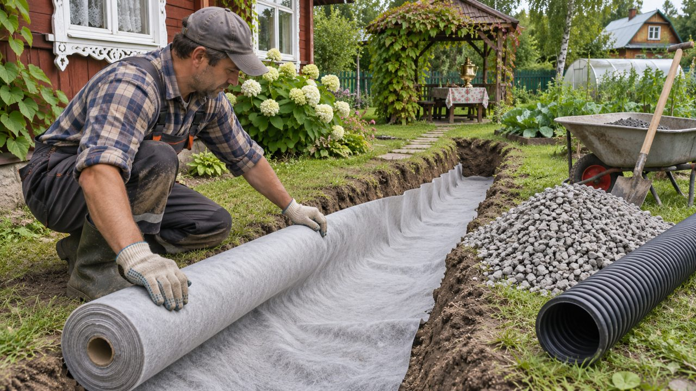
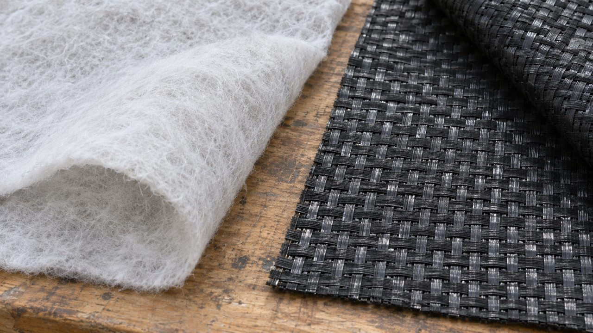
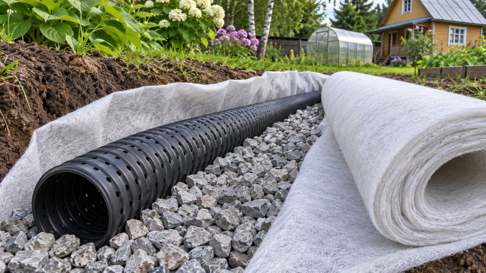
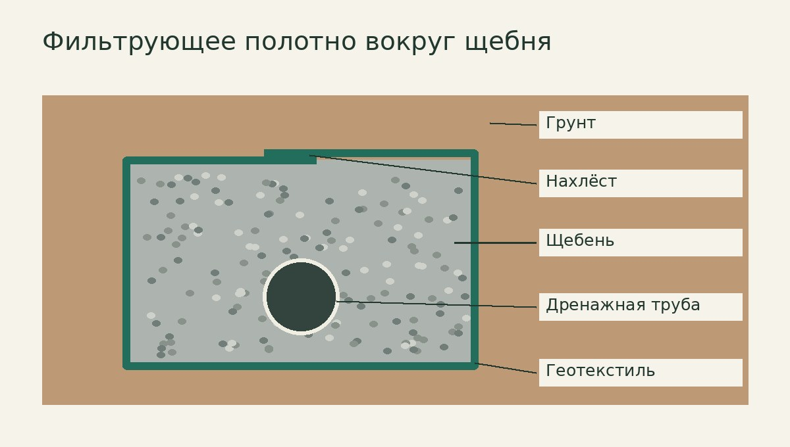
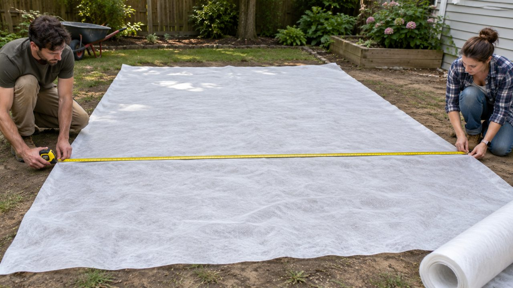
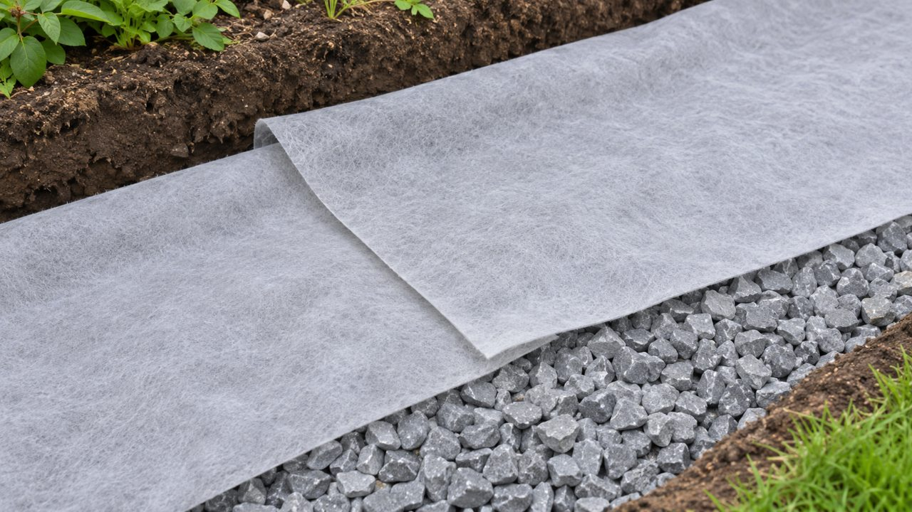

Геотекстиль для дренажа выбирают по тому, как полотно пропускает воду и задерживает частицы именно вашего грунта. Для обычной дачной дрены начать поиск можно с нетканого иглопробивного полотна, для которого производитель прямо указывает назначение «фильтрация» или «дренаж». Маркировка «200 г/м²» говорит о массе квадратного метра и сама по себе ничего не обещает о размере пор. Ниже — что проверить в паспорте, как уложить полотно и сколько купить для вашей траншеи.

## С чего начать выбор

Сначала определите, какую задачу должна решать система. Перфорированная труба с фильтрующей обсыпкой собирает воду, которая доходит до дрены через грунт. Воду с крыши обычно собирают водостоком и ведут по отдельной линии. Если после ливня стоят лужи, а грунт между дождями подсыхает, начните с проверки рельефа и пути поверхностного стока. Покупка более плотной ткани эту задачу не решит.

| Ситуация | Что искать | Что проверить до покупки |
|---|---|---|
| Садовая дрена в песчаном или смешанном грунте | Полотно для фильтрации, обычно нетканое иглопробивное | В паспорте есть размер отверстий, проход воды через полотно и показатели прочности |
| Суглинок, глина, пылеватые прослойки | Фильтр, подобранный под состав грунта и обсыпку | Уточните гранулометрию грунта. Если грунт сильно пылеватый или неоднородный, обсудите схему фильтра с проектировщиком |
| Труба уже в заводской оболочке | Трубу по назначению и внешнюю обсыпку по выбранной схеме | Оболочка защищает отверстия трубы. Полотно вокруг щебня выполняет другую задачу — отделяет обсыпку от грунта |
| Основание дорожки | Полотно для разделения грунта и основания с подходящей прочностью | У дорожки другой режим нагрузки. Сверьте конструкцию в инструкции по [дорожке из щебня](https://mir-doma.pro/dorozhka-iz-shchebnya-svoimi-rukami/) |
| Дренаж защищает фундамент или подпорную стену | Фильтр как часть проекта дренажа | Сначала проверяют грунт, приток и место выпуска воды. Спецификацию полотна берут из проекта |

Для выбора трассы, глубины и места выпуска начните с разбора [дренажа участка на глине](https://mir-doma.pro/drenazh-uchastka-na-glinistoy-pochve/). Здесь считаем только полотно для уже выбранного сечения.

## Что проверить в паспорте

1. **Назначение и артикул.** Найдите техлист именно на тот рулон, который продают. Слова «геоткань», «дорнит» и цвет полотна не заменяют паспорт.
2. **Характерный размер отверстий.** В паспорте может быть указан O₉₀ по ISO 12956 или AOS по другому стандарту. Сравнивайте значения, полученные одним методом. Фильтр должен удерживать грунт и пропускать воду без быстрого засорения. Оценить это по виду рулона нельзя.
3. **Проход воды поперёк полотна.** Ищите показатель водопроницаемости перпендикулярно плоскости. Сравнивайте значения при одинаковом методе и условиях испытания.
4. **Стойкость к проколу и разрыву.** Полотно должно пережить укладку и засыпку щебнем. Если на стенках торчат острые обломки, подготовьте основание до укладки. Более тяжёлый рулон сам по себе не гарантирует нужной прочности.
5. **Рабочая ширина.** Проверьте, хватит ли рулона, чтобы одним куском обойти дно, две боковые стенки и закрыть обсыпку сверху с нахлёстом.

Критерии удержания грунта, водопроницаемости и стойкости к засорению описаны в [инженерном руководстве FHWA по геосинтетическим фильтрам](https://www.fhwa.dot.gov/engineering/geotech/pubs/05037/07a.cfm).

### Можно ли выбирать по плотности

В рознице значения 150 и 200 г/м² удобны как фильтр каталога. Если два полотна весят одинаково, их поры и водопроницаемость всё равно могут отличаться. Попросите у продавца паспорт обоих артикулов и проверьте назначение, отверстия, проход воды и прочность. Для сложного грунта подбирать фильтр стоит по данным грунта и требованиям системы.

## Как полотно лежит в траншее

В показанном узле полотно отделяет щебень от грунта с боков, снизу и сверху. Перед раскроем снимите размеры **именно щебёночной обсыпки**. Если над ней будет слой земли, его высота в расчёт полотна не входит. Для траншеи с наклонными стенками измерьте фактический путь полотна по дну, обеим стенкам и верху. Формула ниже рассчитана на прямоугольное сечение.

## Как рассчитать ширину и длину рулона

**Ширина полотна = 2 × ширина обсыпки + 2 × её высота + верхний нахлёст.** Одна ширина приходится на дно, вторая — на верх обсыпки. Нахлёст укажите по проекту или инструкции к материалу.

Например, при ширине 0,40 м, высоте 0,35 м и верхнем нахлёсте 0,25 м понадобится полоса шириной **1,75 м**. Для непрерывной линии 20 м это **35 м² полотна без припусков**. Если взять рулон шириной 2 м, для такой линии покупают 20 погонных метров, то есть 40 м² рулонного материала. Стыки по длине, торцы, ответвления и подрезку прибавьте отдельно.

<!-- wp:html -->

  <form>
    <fieldset>
      <legend>Калькулятор полотна для дренажа</legend>
      
<label>Длина прямой линии, м <input name="length" type="number" min="0.01" step="any" value="20" required></label>

      
<label>Ширина щебёночной обсыпки, м <input name="width" type="number" min="0.01" step="any" value="0.40" required></label>

      
<label>Высота щебёночной обсыпки, м <input name="height" type="number" min="0.01" step="any" value="0.35" required></label>

      
<label>Верхний нахлёст, м <input name="overlap" type="number" min="0" step="any" value="0.25" required></label>

      
<label>Суммарный припуск по длине, м <input name="extra" type="number" min="0" step="any" value="0" required></label>

      <button type="submit">Рассчитать</button>
      
<output aria-live="polite">Ширина полосы 1,75 м · длина 20 м · площадь 35 м².</output>

      
Размеры 0,40 × 0,35 м и нахлёст 0,25 м приведены для примера. Сверьте ширину рулона с результатом перед покупкой.

    </fieldset>
  </form>
  

<!-- /wp:html -->

Для нескольких отдельных веток посчитайте каждую отдельно. Если размеры сечения одинаковы и куски выкраиваются из одного рулона, сложите потребную длину с припусками на каждую ветку.

## Укладка и проверка перед засыпкой

1. **Разложите полотно по подготовленному дну и стенкам.** Оставьте свободные края по обеим сторонам. Полотно должно лечь по углам без натяжения.
2. **Сделайте подсыпку и уложите трубу по выбранной схеме.** Не меняйте уклон ради удобства раскроя. Трубу и щебень располагайте по проекту или инструкции системы.
3. **Закройте щебень сверху.** Проверьте верхний нахлёст по всей трассе. Если полосу пришлось стыковать по длине, проверьте и эти стыки. До обратной засыпки поправьте места, где видно щебень, и повреждённые участки.
4. **Проверьте выпуск и доступ для обслуживания.** До засыпки сфотографируйте трассу и места поворотов. Это пригодится, если потребуется найти трубу или открыть ревизию.

## Частые ошибки

- **Покупают нужную площадь в слишком узком рулоне.** Сначала считают ширину целой полосы, затем погонные метры.
- **Закрывают бока, оставив щебень открытым сверху.** Частицы обратной засыпки могут попасть в обсыпку через открытый участок.
- **Подбирают ткань до решения, куда уйдёт вода.** Даже правильно собранная дрена зависит от рабочего выпуска. Для дождевой воды сначала проверьте схему [водостока с крыши](https://mir-doma.pro/vodostok-svoimi-rukami/) и дальнейший маршрут стока.
- **Принимают мокрый участок за признак высокого уровня грунтовых вод.** Лужи после дождя и постоянно влажный грунт требуют разных проверок. Начните с наблюдения за участком в дождь и после нескольких сухих дней.

## Частые вопросы

### Какой плотности геотекстиль нужен для дренажа?

Одного универсального значения нет. Для бытовой дрены можно сравнить фильтрующие полотна в диапазоне 150–200 г/м², если их паспорта подтверждают назначение. Окончательно выбирайте по грунту, размеру отверстий, проходу воды и прочности.

### Можно ли заменить геотекстиль укрывным материалом?

Для дренажа нужен материал с известными фильтрующими и механическими характеристиками. Если у укрывного полотна нет паспорта для работы в грунте, оценить его пригодность для траншеи нельзя.

### Зачем полотно вокруг щебня, если труба уже в геотекстиле?

Заводской фильтр защищает входы в трубу. Фильтр вокруг щебня помогает сохранить обсыпку, отделяя её от грунта. Нужны ли оба слоя в конкретном узле, определяет схема дренажа.

### Какой ширины рулон брать?

Сложите ширину дна, ширину верха обсыпки, длину обеих боковых стенок и верхний нахлёст. Возьмите рулон шириной не меньше полученного значения или учтите швы, если проектом предусмотрен раскрой из нескольких полотен.

*Фотографические иллюстрации созданы для статьи. Схема условная, размеры задаются по месту.*
