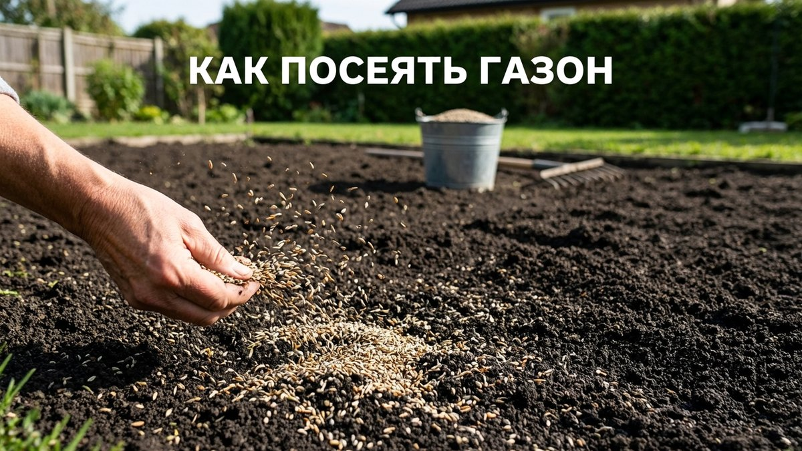
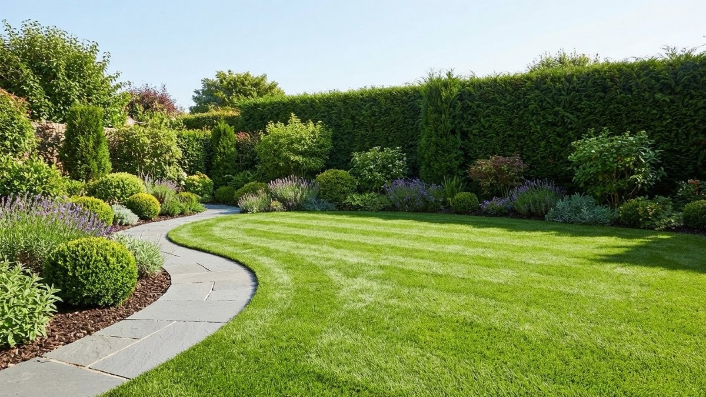
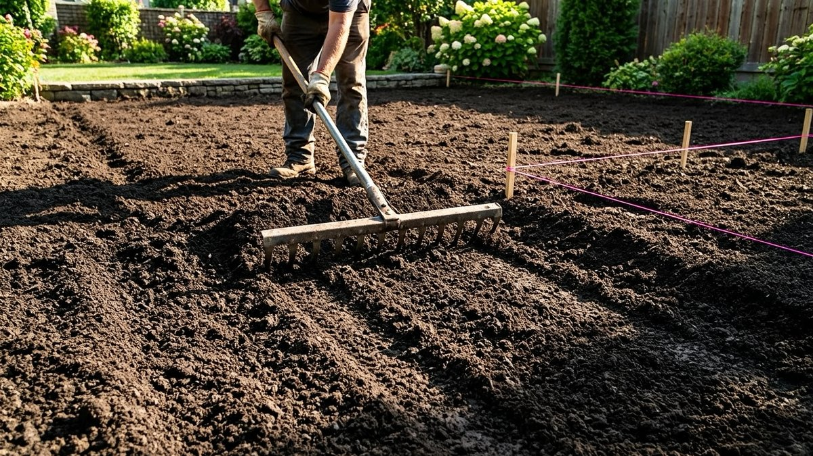
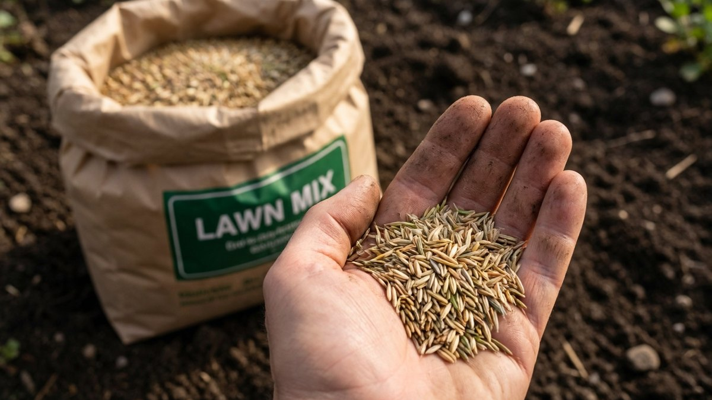
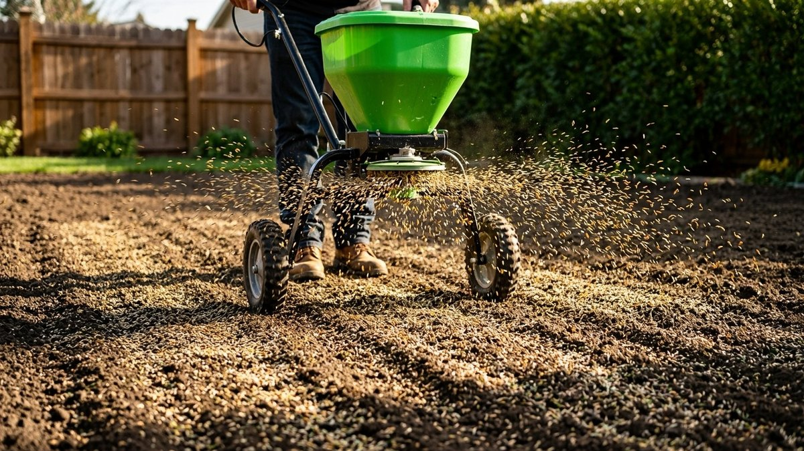
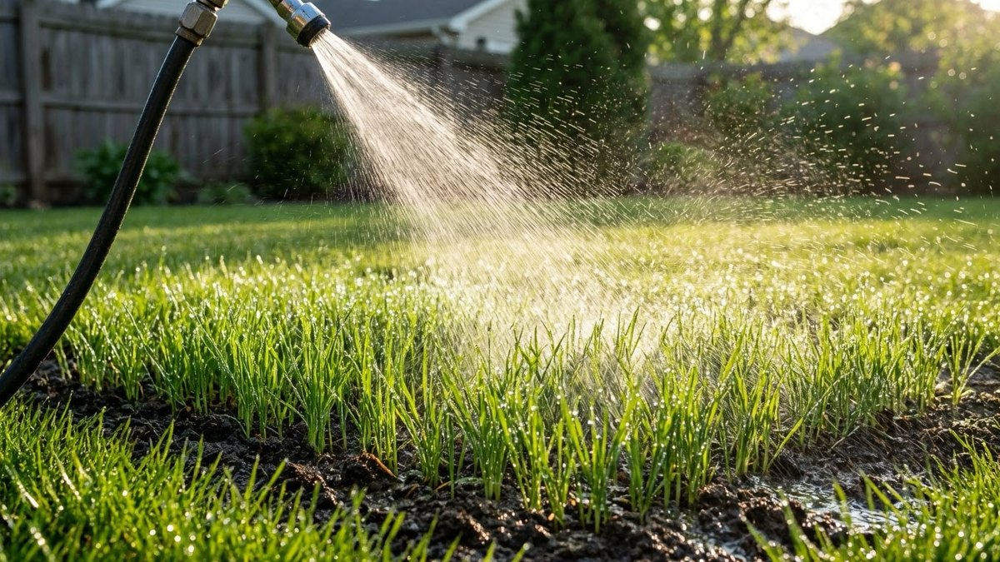

Ровный зелёный газон превращает участок в ухоженный сад и служит фоном для клумб, дорожек и зоны отдыха. И вырастить его своими руками вполне реально — важно лишь не спешить с подготовкой почвы и правильно ухаживать за молодыми всходами. Разберём по шагам, как посеять газон своими руками: когда сеять, как подготовить участок, выбрать травосмесь, посеять и вырастить плотный красивый газон.

## 🌱 Когда сеять газон

Семена газонных трав прорастают, когда почва на глубине 5 см прогрелась до
+10…+12 °C, а днём держится +15…+25 °C. Отсюда три срока:

| Срок | Средняя полоса | Плюсы | Минусы |
|---|---|---|---|
| Весна | конец апреля — конец мая | впереди весь сезон, трава окрепнет к зиме | сорняки прорастают вместе с газоном, к июню нужен частый полив |
| Конец лета | с середины августа до 10–15 сентября | почва тёплая и влажная, сорняков меньше, жары нет | при позднем посеве трава не успеет укорениться |
| Подзимний посев | конец октября — ноябрь, при устойчивых +2…+3 °C | семена проходят естественную закалку, всходы ранней весной | часть семян смывает талой водой, норму поднимают в 1,5 раза |

Для осеннего срока правило одно: от всходов до устойчивых заморозков нужно
6–8 недель, иначе молодая трава вымерзнет. Летом сеять можно, но при жаре
выше +28 °C всходы без полива 2 раза в день сгорают — лучше дождаться
середины августа.

## 🌿 Посевной или рулонный газон

Прежде чем начинать, стоит решить, каким способом устраивать газон:

- **Посевной** — трава выращивается из семян прямо на участке. Дешевле, выбор травосмесей больше, но требует времени и терпения: полноценный газон формируется за сезон, а первый год за ним нужен внимательный уход.
- **Рулонный** — готовый газон, выращенный в питомнике и срезанный пластами с дерниной. Его раскатывают на подготовленную почву и получают ровный зелёный ковёр почти сразу. Дороже, зато быстро и без хлопот со всходами.

Подготовка почвы в обоих случаях одинакова — разница лишь в том, сеете вы семена или укладываете готовую дернину. Для большинства дачников посевной газон выгоднее и интереснее, а рулонный выбирают, когда результат нужен быстро. Дальше разберём именно посевной способ — если выбрали рулонный, уход в первые недели после укладки устроен иначе, разбор по шагам в статье [«Уход за рулонным газоном после укладки»](https://mir-doma.pro/ukhod-za-rulonnym-gazonom-posle-ukladki/).

## 🧰 Что понадобится

Для работы пригодятся: лопата и грабли, каток (или самодельный тяжёлый валик), травосмесь, стартовое удобрение, шланг или лейка с рассеивателем и, по возможности, сеялка-разбрасыватель.

## 🚜 Шаг 1. Подготовка участка

Это самый важный этап — от него зависит, будет ли газон ровным. На
подготовку закладывайте 3–5 недель до посева:

- **Сорняки — за 2–3 недели до перекопки.** Многолетники (пырей, осот,
  одуванчик) перекопкой не убрать: обрывки корней прорастают. Участок
  обрабатывают гербицидом сплошного действия на основе глифосата по
  инструкции, через 2–3 недели при отрастании — повторно. Без химии —
  выбирают корни вилами и держат участок под чёрной плёнкой месяц.
- **Перекопать на 20–25 см**, выбрать корни и камни, разбить комья.
- **Проверить кислотность.** Газонные травы растут при pH 5,5–7. Кислую
  почву раскисляют доломитовой мукой заранее: сколько вносить по типу
  почвы, разобрано в статье про [известкование
  почвы](https://mir-doma.pro/izvestkovanie-pochvy-osenyu/).
- **Плодородный слой — 10–15 см.** На бедном песке или после стройки
  завозят плодородный грунт и распределяют по участку; на глине вносят
  2–3 см песка и перекапывают. Если вода после дождя стоит лужами больше
  суток, сначала нужен дренаж — как его устроить на глине, описано в
  статье про [дренаж глинистого
  участка](https://mir-doma.pro/drenazh-uchastka-na-glinistoy-pochve/).
- **Выровнять** граблями и правилом из доски: бугры срезать, ямки
  засыпать. Уклон от дома 1–2 см на метр, чтобы вода уходила.
- **Стартовое удобрение** — комплексное, с повышенной долей фосфора, в норме
  с упаковки (обычно 30–50 г на 1 м²), заделать граблями перед посевом.

Как вписать газон в общий план участка вместе с дорожками и зонами отдыха — в статье про [планировку участка](https://mir-doma.pro/planirovka-uchastka-10-sotok/).

## 🌾 Шаг 2. Выбор травосмеси

Готовая смесь почти всегда состоит из трёх-четырёх трав. Читайте состав на
упаковке: свойства газона определяет то, чего в смеси больше.

| Трава | Всходы | Чем хороша | Слабое место |
|---|---|---|---|
| Райграс пастбищный | 5–7 дней | быстро закрывает землю, держит вытаптывание | живёт 3–4 года, в морозные малоснежные зимы выпадает |
| Овсяница красная | 10–14 дней | терпит тень, засуху и бедную почву | дерн рыхлее, чем у мятлика |
| Мятлик луговой | 14–21 день | самый плотный дерн, держит нагрузку, зимостоек | медленно растёт первый год |
| Полевица побегообразующая | 10–14 дней | тонкий бархатный партер | нужна частая низкая стрижка и полив |

По назначению:

- **Универсальный (садово-парковый)** — овсяница, мятлик и райграс
  примерно поровну. Самый практичный для дачи: прощает ошибки в уходе.
- **Спортивный и для детской площадки** — больше райграса и мятлика:
  быстро зарастают протоптанные места.
- **Теневой** — больше половины овсяницы красной; под плотной кроной ели
  ни одна смесь не даст ровного ковра.
- **Партерный** — овсяница и полевица, ковёр для парадной зоны, не любит
  ходьбы.

Смесь, где райграса больше половины, всходит за неделю, но через 3–4 года
редеет: райграс выпадает, а остальные травы не успели занять место.

## 🧮 Калькулятор: сколько семян, грунта и удобрения

Посчитайте материалы под свою площадь. Норма семян — ориентир для
готовых смесей; если на упаковке указана другая, подставьте её.

<!-- wp:html -->

  
Расчёт семян, грунта и удобрения для посевного газона

  <label class="md-calc__label" for="mdLawnA">Площадь газона, м²</label>
  <input type="number" id="mdLawnA" class="md-calc__input" min="0" step="1" value="100">
  <label class="md-calc__label" for="mdLawnS">Срок и способ посева</label>
  <select id="mdLawnS" class="md-calc__input">
    <option value="1">Весна или конец лета — обычная норма</option>
    <option value="1.5">Подзимний посев — норма ×1,5</option>
    <option value="0.5">Подсев в редкий газон — половина нормы</option>
  </select>
  <label class="md-calc__label" for="mdLawnN">Норма семян с упаковки, г на 1 м²</label>
  <input type="number" id="mdLawnN" class="md-calc__input" min="0" step="5" value="40">
  <label class="md-calc__label" for="mdLawnH">Слой привозного грунта, см (0 — если не завозите)</label>
  <input type="number" id="mdLawnH" class="md-calc__input" min="0" step="1" value="0">
  
Заполните поля

<!-- /wp:html -->

## ⚖️ Шаг 3. Финальное выравнивание и уплотнение

Перед посевом подготовленную почву **прикатывают катком** и дают ей осесть 1–2 недели — за это время проявляются неровности и всходят оставшиеся сорняки, которые удаляют. Затем поверхность ещё раз рыхлят граблями на пару сантиметров, создавая мелкую ровную «постель» для семян. Уплотнённая, но взрыхлённая сверху почва — залог дружных всходов.

## 🌱 Шаг 4. Посев

Теперь сам посев:

- Сеют в сухую безветренную погоду. Норму расхода семян смотрят на упаковке (обычно 30–50 г на 1 м²); по краям сеют чуть гуще.
- Для равномерности семена рассыпают **вдоль и поперёк** участка, разделив на две части, или используют сеялку.
- Заделывают семена веерными граблями на глубину около 1 см и **прикатывают катком** — так они плотно контактируют с почвой.
- Сверху можно замульчировать тонким слоем торфа, чтобы сохранить влагу.

## 💧 Шаг 5. Полив и всходы

После посева газон аккуратно поливают через мелкий распылитель, чтобы не размыть семена. До появления всходов почва должна быть постоянно влажной — в сухую погоду поливают ежедневно, лёгким дождеванием. Первые всходы появляются через 1–2 недели, полное задернение — за месяц-полтора. Пока трава не окрепла, по газону не ходят.

## ✂️ Уход за молодым газоном

Когда трава подрастёт до 8–10 см, проводят **первую стрижку**, срезая лишь верхушки (не короче 5 см) хорошо заточенной косилкой. Дальше газон стригут регулярно, поддерживая высоту 4–6 см. Через 3–4 недели после всходов дают первую подкормку — молодой траве нужно питание для загущения; общие принципы питания растений разбирали в статье про [летние подкормки](https://mir-doma.pro/letnie-podkormki-ovoshchey/). Регулярные полив, стрижка и подкормки быстро превращают редкие всходы в плотный ковёр. Чтобы не поливать вручную каждый раз, на этом же этапе удобно продумать [систему автоматического полива газона своими руками](https://mir-doma.pro/sistema-poliva-gazona-svoimi-rukami/) — трубы и дождеватели проще заложить, пока участок ещё не засеян окончательно. Для уже взрослого газона осенний уход устроен иначе — последняя стрижка, аэрация и подкормка без азота разобраны в статье [уход за газоном осенью](https://mir-doma.pro/ukhod-za-gazonom-osenyu/). А если даже при правильном уходе на газоне появились редкие пятна — вытоптали, залило или завелись вредители, — их ремонт разобран в статье [проплешины на газоне: как исправить](https://mir-doma.pro/proplesiny-na-gazone-kak-ispravit/).

## ❌ Частые ошибки

- **Плохо выровняли почву** — газон получается кочковатым, в ямах стоит вода.
- **Пропустили усадку** — посеяли сразу после перекопки, и грунт просел неровно.
- **Пересушили всходы** — при нерегулярном поливе молодая трава сгорает.
- **Слишком короткая или ранняя стрижка** — ослабляет неокрепший газон.
- **Ходьба по посевам** — вытаптывают всходы до укоренения.
- **Перекопали, не убрав многолетние сорняки** — пырей и осот из обрывков корней прорастают через газон, и выполоть их потом можно только вместе с дерном.
- **Посеяли гуще 60 г на 1 м²** — всходы душат друг друга и выпревают.

## ❓ Частые вопросы

**Когда лучше сеять газон — весной или осенью?**
Оба срока рабочие. Весной (конец апреля — май, почва +10 °C) у травы впереди весь сезон, но сорняки всходят вместе с ней. В конце лета (до 10–15 сентября в средней полосе) сорняков меньше и не нужен частый полив, но от всходов до заморозков должно остаться 6–8 недель.

**Можно ли посеять газон под зиму?**
Да: в конце октября — ноябре, когда земля остыла до +2…+3 °C и семена уже не взойдут до весны. Норму поднимают в 1,5 раза, участок готовят заранее, на склонах такой посев не делают — семена смоет талой водой.

**Сколько нужно семян на сотку газона?**
При норме 30–50 г на 1 м² — 3–5 кг на 100 м², плюс 10% на края. Для подзимнего посева — 4,5–7,5 кг.

**Какой расход семян на 1 м²?**
Обычно 30–50 г на квадратный метр — точную норму указывают на упаковке травосмеси. По краям газона сеют немного гуще.

**Нужно ли перекапывать участок под газон?**
Да, почву перекапывают, очищают от сорняков и камней и тщательно выравнивают. Именно от подготовки зависит, будет ли газон ровным.

**Через сколько всходит газон?**
Первые всходы появляются через 1–2 недели, а плотное задернение — примерно за месяц-полтора при регулярном поливе.

**Когда первый раз косить газон?**
Когда трава подрастёт до 8–10 см. Первую стрижку делают щадящей, срезая только верхушки и не короче 5 см.

**Можно ли сеять газон летом?**
Можно, если есть возможность поливать 1–2 раза в день по 5 л на 1 м². При жаре выше +28 °C всходы сгорают даже с поливом — посев лучше перенести на середину августа.

---

Посеять газон своими руками несложно — успех решают тщательная подготовка почвы, правильный срок посева и регулярный уход за всходами. Наберитесь терпения на этапе выравнивания, и уже через сезон у вас будет плотный зелёный газон. Дополните его аккуратными [садовыми дорожками](https://mir-doma.pro/sadovye-dorozhki-svoimi-rukami/) — и участок преобразится.
