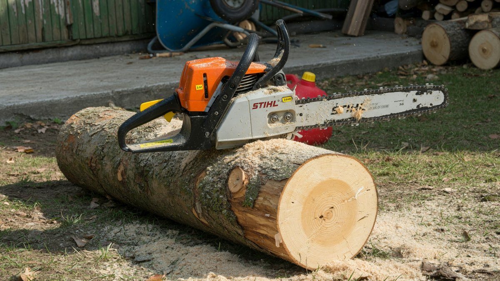
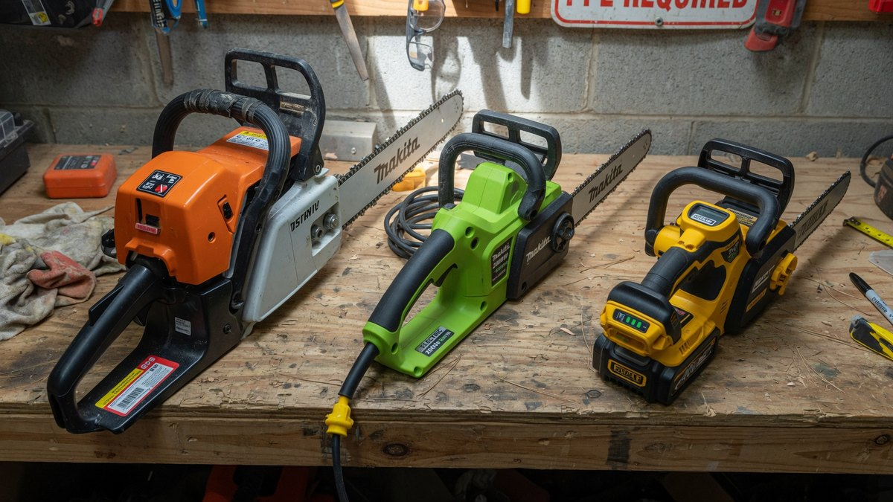
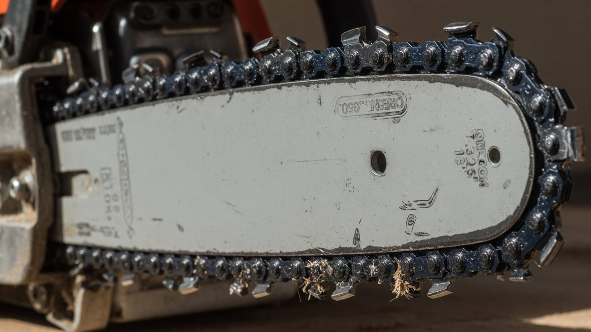
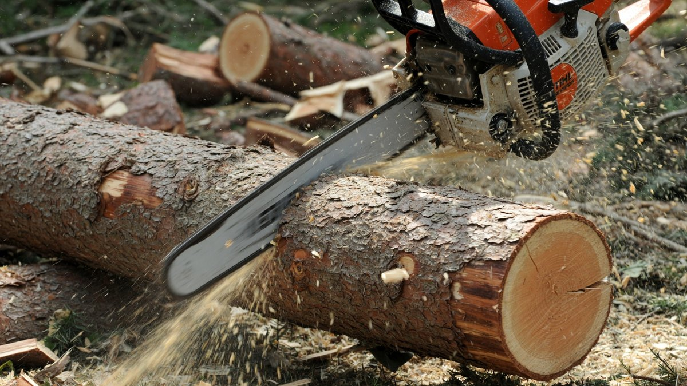
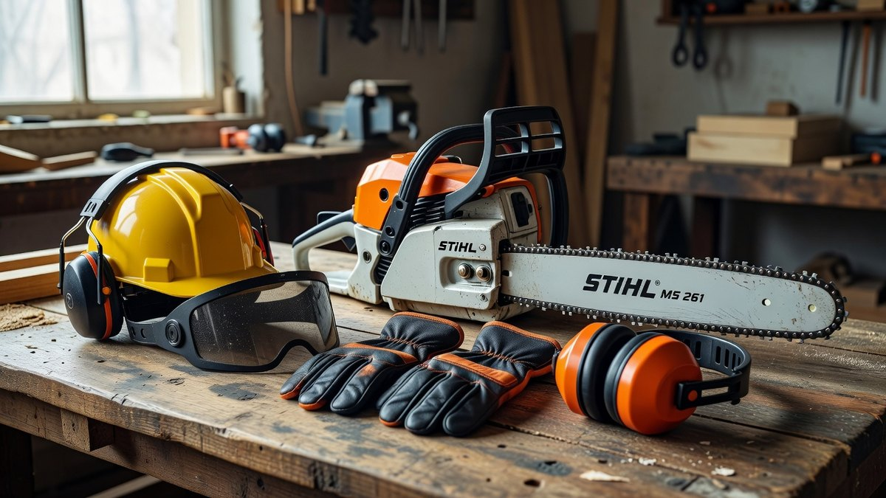
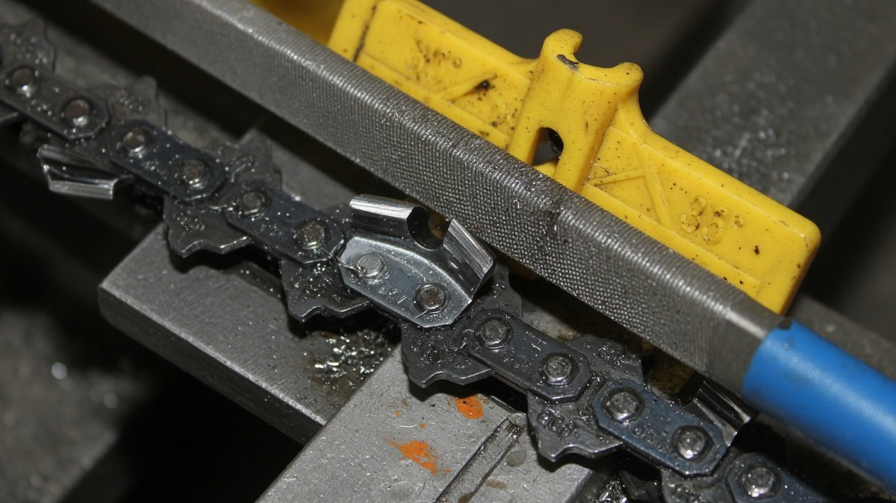

Бензопила на даче быстро становится незаменимой: ею пилят дрова, спиливают старые деревья, режут ветки после обрезки и заготавливают материал для стройки. Но моделей на прилавке десятки, и легко переплатить за ненужную мощность или, наоборот, купить слабый инструмент. Разберём, как выбрать бензопилу для дачи: чем отличаются виды, на что смотреть при покупке и какая пила подойдёт именно под ваши задачи.

## 🪚 Зачем нужна пила на даче

Прежде чем выбирать, определите, что вы будете пилить — от этого зависит нужная мощность и класс инструмента. Типичные дачные задачи:

- заготовка и распиловка дров;
- спил старых и сухих деревьев;
- обрезка толстых веток (в том числе осенью — см. [подготовку сада к зиме](https://mir-doma.pro/podgotovka-sada-k-zime/));
- распил досок и бруса для построек;
- расчистка участка от поросли и валежника.

Если задачи разовые и лёгкие — хватит простой пилы, если пилить придётся много и подолгу — нужен инструмент помощнее.

## ⚡ Бензиновая, электрическая или аккумуляторная

Первый выбор — тип питания. У каждого свои сильные стороны:

| Тип | Плюсы | Минусы |
|---|---|---|
| Бензиновая | Мощная, автономная, для тяжёлых работ | Шумная, тяжёлая, нужен бензин и обслуживание |
| Электрическая | Тихая, лёгкая, дешевле, не нужен бензин | Привязана к розетке, кабель мешает |
| Аккумуляторная | Мобильная, тихая, лёгкая | Ограниченное время работы, дороже |

**Бензиновая** — универсальный выбор для дачи, где нужна автономность и мощность (дрова, спил деревьев). **Электрическая** удобна для работ рядом с домом (обрезка, распил досок). **Аккумуляторная** хороша для лёгкой обрезки в саду, где не дотянуть провод.

Если электричество на участке подаётся только от генератора, электропила добавит к нагрузке ощутимый пусковой ток — при выборе генератора это стоит учесть отдельно, как и любой другой электроинструмент: [какой мощности генератор нужен для дачи](https://mir-doma.pro/kakoy-generator-nuzhen-dlya-dachi/).

## 🔧 На что смотреть при выборе

Главные цифры в карточке пилы — мощность, объём двигателя и длина шины. Они
связаны между собой: под длинную шину нужен мощный мотор, иначе цепь
застревает в резе и двигатель перегревается. Остальное — вес, антивибрация,
натяжение цепи — решает, сколько вы продержитесь без усталости.

| Класс | Мощность | Объём двигателя | Шина | Вес без шины | Сколько работать без перерыва |
|---|---|---|---|---|---|
| Бытовая | 1,3–2,2 кВт (1,8–3 л. с.) | 30–45 см³ | 30–40 см | 4–5 кг | 30–40 минут, потом пауза |
| Полупрофессиональная (фермерская) | 2–3 кВт (2,7–4 л. с.) | 40–60 см³ | 35–45 см | 5–6 кг | до 2–4 часов в день |
| Профессиональная | от 3 кВт (от 4 л. с.) | от 60 см³ | 45–75 см | от 6 кг | полная смена |

Цифры — ориентир по рынку: точный режим работы указан в инструкции к модели.

- **Мощность и шина в паре.** До 1,5 кВт — шина 30–35 см, 1,5–2,2 кВт —
  35–40 см, 2,2–3 кВт — 40–45 см, больше 3 кВт — от 45 см. Если продавец
  предлагает поставить на бытовую пилу шину 45 см «на вырост», мотор будет
  работать на пределе.
- **Длина шины и толщина бревна.** Рабочая длина шины на 2–4 см меньше
  заявленной: часть закрыта корпусом. Берите шину на 5–10 см длиннее
  диаметра брёвен, которые пилите чаще всего. Для дров 25–30 см это
  35–40 см.
- **Вес.** Разница в 1 кг заметна через полчаса работы. Сравнивайте вес
  без шины и топлива — так его указывают в характеристиках, с шиной и
  полными баками добавьте 1–1,5 кг.
- **Натяжение цепи без ключа** — удобно, если пила новая для вас: подтянуть
  цепь можно прямо на чурбаке.
- **Антивибрация** — пружины или резиновые демпферы между мотором и
  рукоятками. Для дров по несколько часов обязательна.
- **Тормоз цепи** — щиток перед верхней рукояткой; при отдаче рука его
  толкает, и цепь встаёт за доли секунды. Без исправного тормоза пилой не
  работают.
- **Лёгкий запуск** (декомпрессионный клапан, пружинный стартер) — полезен,
  если пилить будет человек, которому тяжело дёргать шнур.

### Цепь: шаг и толщина звена

Цепь подбирают под шину и мощность, а не наоборот: её параметры выбиты на
хвостовике шины и указаны в инструкции.

| Шаг цепи | Где ставят | Толщина хвостовика (паз) |
|---|---|---|
| 3/8″ низкопрофильная (Picco, 3/8 LP) | бытовые пилы до 2 кВт | 1,1–1,3 мм |
| 0,325″ | полупрофессиональные 2–3 кВт | 1,3–1,5 мм |
| 3/8″ стандартная | мощные и профессиональные | 1,5–1,6 мм |

Чем меньше шаг, тем мягче рез и меньше вибрация, но медленнее пила идёт в
толстом бревне. Запасную цепь берите с теми же шагом, пазом и числом
звеньев — эти три цифры написаны на упаковке старой цепи.

## 🎯 Какую бензопилу выбрать под задачу

Сориентироваться проще по сценарию: сколько пилить в год и насколько толстые
брёвна.

| Задача | Объём | Класс | Шина | Мощность |
|---|---|---|---|---|
| Ветки после обрезки, пару деревьев в год | до 2 м³ | аккумуляторная, электрическая или лёгкая бытовая | 25–35 см | 1–1,5 кВт |
| Дрова для бани и камина | 2–5 м³ в год | бытовая | 35–40 см | 1,5–2 кВт |
| Дрова для отопления дома | 5–15 м³ в год | полупрофессиональная | 40–45 см | 2–3 кВт |
| Спил старых деревьев, брёвна толще 40 см | разово | полупрофессиональная или аренда | 45–50 см | от 2,5 кВт |
| Стройка: брус, доска, столбы | по сезону | бытовая с запасом мощности или полупрофессиональная | 35–40 см | 1,8–2,5 кВт |

Сколько дров уходит на зиму в доме вашей площади и сколько это кубометров
пилить, считает калькулятор в статье [сколько дров нужно на
зиму](https://mir-doma.pro/skolko-drov-nuzhno-na-zimu/) — подставьте этот
объём в калькулятор ниже.

Не гонитесь за профессиональными моделями «на вырост» — они тяжёлые и
дорогие, а их ресурс на даче не нужен. Если толстое дерево нужно спилить
один раз, дешевле взять мощную пилу в аренду или позвать арбориста:
дерево у дома или у проводов валить самому опасно.

## 🧮 Калькулятор: какая пила нужна и сколько масла в смесь

Укажите толщину брёвен, объём работы на год и сколько бензина заливаете в
канистру. Калькулятор подскажет длину шины, мощность и класс пилы, а также
сколько двухтактного масла добавить в бензин.

<!-- wp:html -->

  
Подбор бензопилы и расчёт топливной смеси

  <label class="md-calc__label" for="mdSawD">Диаметр брёвен, которые пилите чаще всего, см</label>
  <input type="number" id="mdSawD" class="md-calc__input" min="0" step="1" value="25">
  <label class="md-calc__label" for="mdSawV">Сколько дров пилить за год, м³</label>
  <input type="number" id="mdSawV" class="md-calc__input" min="0" step="0.5" value="5">
  <label class="md-calc__label" for="mdSawL">Бензин в канистре для смеси, л</label>
  <input type="number" id="mdSawL" class="md-calc__input" min="0" step="0.5" value="1">
  <label class="md-calc__label" for="mdSawR">Пропорция из инструкции к пиле или на масле</label>
  <select id="mdSawR" class="md-calc__input">
    <option value="50">1:50 — большинство современных пил, синтетическое масло</option>
    <option value="40">1:40 — минеральное или полусинтетическое масло</option>
    <option value="25">1:25 — старые пилы, если так указано в инструкции</option>
  </select>
  
Заполните поля

<!-- /wp:html -->

### Топливная смесь: как готовить и хранить

У бензопилы двухтактный двигатель: масло в картер не заливают, оно идёт
вместе с бензином и смазывает поршень. Без масла или со слишком бедной
смесью цилиндр задирается за несколько минут — это самый дорогой ремонт
пилы.

- **Пропорция — из инструкции к пиле.** 1:50 значит 20 мл масла на 1 л
  бензина, 1:40 — 25 мл, 1:25 — 40 мл. Если на масле написано одно, а в
  инструкции к пиле другое, слушайте инструкцию.
- **Бензин** — АИ-92 или АИ-95, как указал производитель. Масло — только
  для двухтактных двигателей с воздушным охлаждением (маркировка 2T, класс
  API TC или JASO FC/FD), не лодочное и не автомобильное.
- **Смешивают в канистре**: сначала половину бензина, затем всё масло,
  взболтать, долить остаток. Шприц или мерная крышка на 20–25 мл дешевле
  одного ремонта.
- **Храните смесь не дольше 2–4 недель.** Бензин теряет лёгкие фракции, масло
  расслаивается, пила начинает плохо заводиться. Готовьте столько, сколько
  выработаете.
- **Масло для цепи — отдельный бак.** Его заливают каждый раз вместе с
  топливом: бака масла обычно хватает на бак смеси. Проверить подачу просто
  — поднесите конец шины к светлой доске и дайте высокие обороты: должна
  появиться полоска брызг.

## 🛡️ Безопасность и уход

Бензопила — травмоопасный инструмент, поэтому безопасность и обслуживание не менее важны, чем выбор модели:

- **Средства защиты.** Работайте в защитных очках или маске, перчатках, наушниках и прочной обуви; удобны специальные защитные штаны.
- **Тормоз цепи и правильная стойка.** Держите пилу двумя руками, не пилите концом шины (риск отдачи), не поднимайте пилу выше плеч.
- **Смазка цепи.** Следите за уровнем масла для смазки цепи — без него шина и цепь быстро изнашиваются.
- **Заточка цепи.** Тупая цепь пилит медленно, «горит» и опасна. Цепь регулярно затачивают напильником или на станке. Напильник подбирают строго по шагу цепи: какой диаметр нужен под вашу цепь и как узнать шаг замером линейкой, разобрано в статье [какой напильник нужен для заточки цепи](https://mir-doma.pro/napilnik-dlya-zatochki-cepi-benzopily/).
- **Обкатка и хранение.** Новую бензопилу обкатывают по инструкции, а на хранение убирают чистой, в сухое место — например, в [сарай](https://mir-doma.pro/saray-svoimi-rukami/).

## 🧰 Что купить вместе с бензопилой

Чтобы пила сразу была готова к работе и служила дольше, к ней стоит взять расходники и аксессуары:

- **Масло для смазки цепи** — расходуется постоянно, без него шина и цепь быстро изнашиваются;
- **Масло для топливной смеси** (для бензиновых) — двухтактное, для приготовления смеси в точной пропорции;
- **Запасная цепь** — чтобы не простаивать, пока основная тупится или на заточке;
- **Напильник или станок для заточки** — цепь нужно регулярно подтачивать;
- **Дровокол** — если бензопила покупается ради дров, колоть распиленные чурки вручную колуном долго; гидравлический дровокол из домкрата можно собрать самому, варианты в статье [дровокол своими руками](https://mir-doma.pro/drovokol-svoimi-rukami/);
- **Канистра для топливной смеси** и воронка;
- **Средства защиты** — очки, перчатки, наушники;
- **Чехол на шину** — для безопасного хранения и переноски.

Эти мелочи стоят недорого, но избавляют от простоев и продлевают жизнь инструменту.

Похожая логика выбора между бензиновым и другим типом двигателя действует
и для более тяжёлой техники — разбор классов и параметров в статье [какой
мотоблок выбрать для дачи](https://mir-doma.pro/kakoy-motoblok-vybrat/).

## ❌ Частые ошибки

- **Покупка избыточно мощной пилы** — тяжело, дорого и не нужно для дачных задач.
- **Слишком длинная шина при малой мощности** — пила «не тянет» и застревает.
- **Работа тупой цепью** — медленно, опасно и вредно для двигателя.
- **Пренебрежение защитой** — бензопила не прощает беспечности.
- **Заливка неправильного топлива** — чистый бензин без масла задирает цилиндр за минуты; смесь старше месяца даёт плохой запуск.
- **Пила без масла в баке цепи** — шина синеет от перегрева, цепь растягивается и слетает.

## ❓ Частые вопросы

**Какая бензопила лучше для дачи?**
Для большинства дачных задач хватает бытовой пилы 1,5–2 кВт с шиной 35–40 см
и весом 4–5 кг: она пилит дрова до 30 см, ветки и доски. Если отапливаете
дом дровами и заготавливаете больше 5 м³ в год, берите полупрофессиональную
на 2–3 кВт.

**Бензиновая или электрическая пила — что выбрать?**
Бензиновая автономна и мощнее — для дров и спила деревьев вдали от розетки.
Электрическая на 1,8–2,4 кВт тише, легче и не требует смеси — для работ у
дома с удлинителем до 30–40 м. Аккумуляторная — для обрезки сада и
веток до 15–20 см.

**Какой длины шина нужна для дачи?**
На 5–10 см длиннее диаметра брёвен, которые вы пилите чаще всего. Для дров
25–30 см — 35–40 см. Шину длиннее 40 см ставят только на пилы мощнее
2,2 кВт.

**Можно ли пилить бревно толще шины?**
Можно распилить с двух сторон бревно до двух длин шины, но это приём для
опытного пильщика: в конце реза легко коснуться древесины концом шины, а
это и есть отдача. Если такие брёвна попадаются регулярно, нужна шина
длиннее и пила мощнее.

**Сколько масла добавлять в бензин для бензопилы?**
По инструкции к пиле. Для пропорции 1:50 — 20 мл масла на литр бензина, для
1:40 — 25 мл, для 1:25 — 40 мл. Масло — двухтактное для воздушного
охлаждения, смесь хранят не дольше 2–4 недель.

**Сколько мощности достаточно для дачной бензопилы?**
Для веток и дров до 5 м³ в год — 1,5–2 кВт. Для отопления дома дровами и
брёвен 30–40 см — 2–3 кВт. Больше 3 кВт на даче нужно редко.

**Как ухаживать за цепью бензопилы?**
Проверять подачу масла перед каждой работой, подтягивать цепь, пока звенья
снизу шины не перестанут провисать, и подтачивать её, как только вместо
стружки летит мелкая пыль. Тупая цепь пилит медленно, перегревается и
чаще даёт отдачу.

---

Правильно подобранная бензопила служит годами и экономит массу сил на даче. Отталкивайтесь от своих задач, не переплачивайте за лишнюю мощность и не забывайте про защиту и уход за цепью. А какие ещё инструменты пригодятся на участке — в статье про [инструменты для дачи](https://mir-doma.pro/instrumenty-dlya-dachi/).
