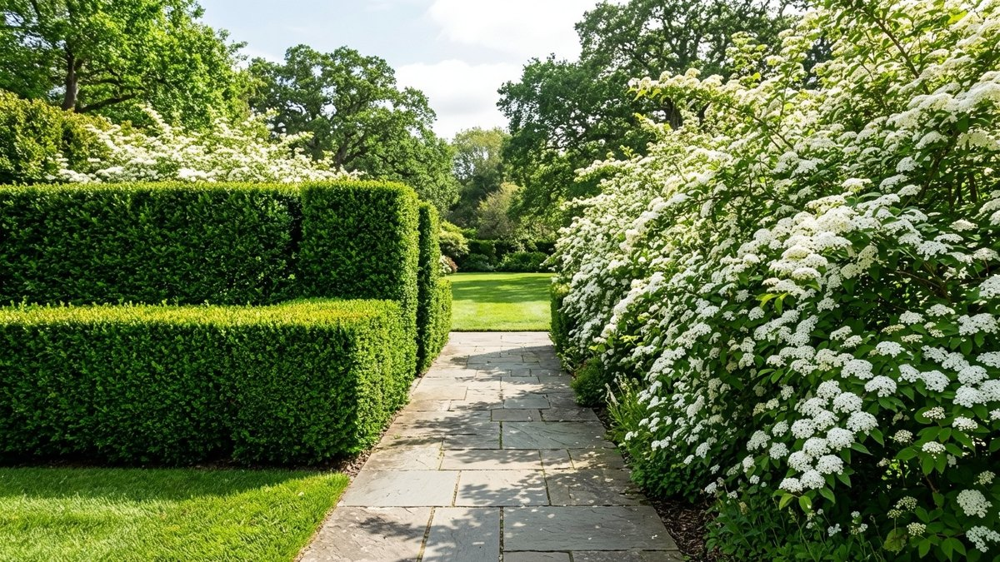
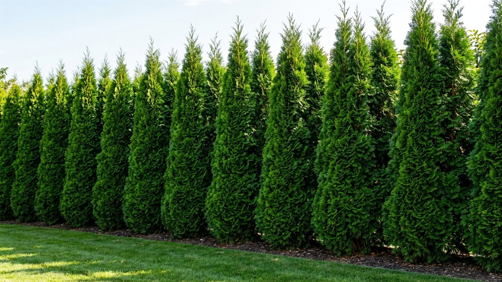
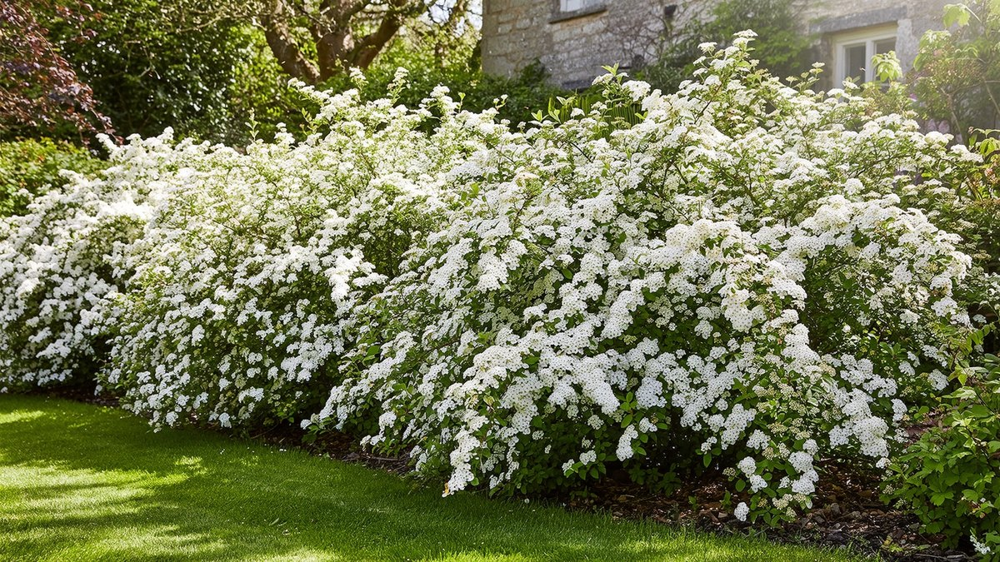
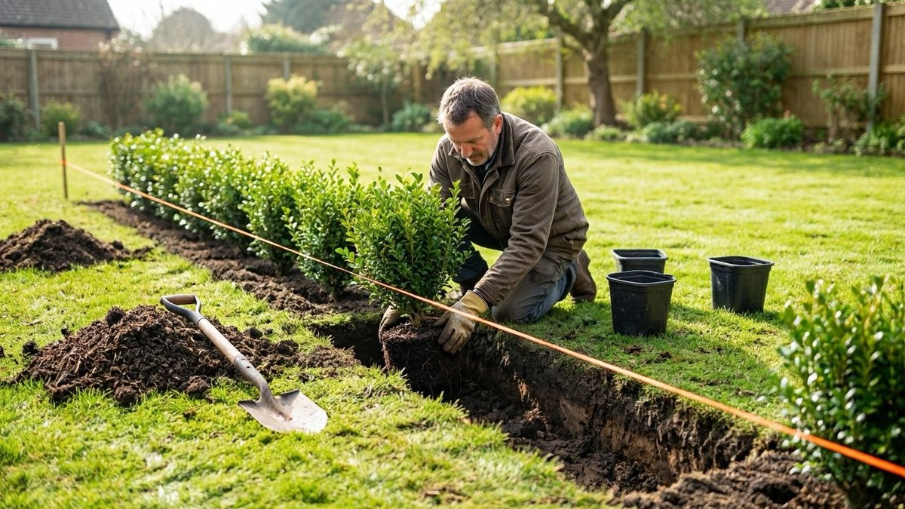
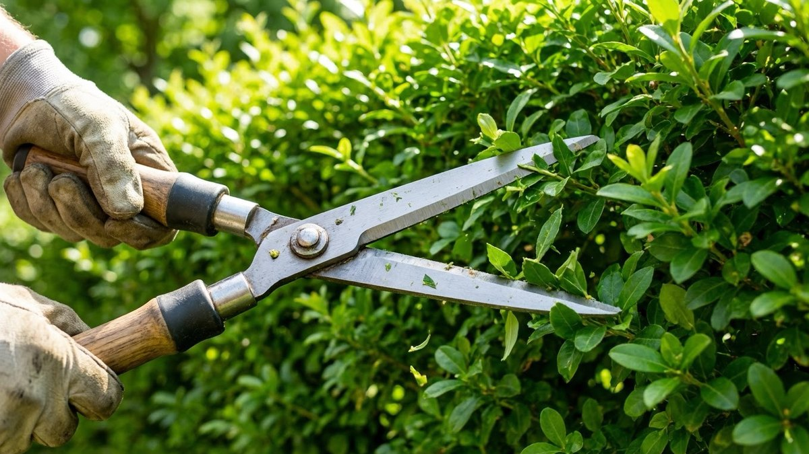

Живая изгородь — это зелёная ограда из растений, которая заменяет или дополняет обычный забор. Она защищает участок от пыли, ветра и посторонних глаз, гасит шум и делает сад по-настоящему уютным. Главный вопрос при её создании — что посадить, чтобы изгородь выросла плотной и быстро. Разберём лучшие быстрорастущие растения для живой изгороди, её виды, а также как правильно посадить и стричь зелёную ограду.

## 🌳 Чем хороша живая изгородь

У зелёной ограды масса плюсов перед глухим забором:

- защищает от пыли, ветра и уличного шума;
- закрывает участок от посторонних взглядов, создавая приватность;
- служит красивым фоном для сада и цветников;
- привлекает птиц и полезных насекомых;
- живёт десятилетиями и с годами становится только гуще.

Минус один — изгородь нужно ждать и за ней ухаживать. Поэтому и выбирают быстрорастущие растения, чтобы результат появился скорее. Как вписать изгородь в общий план участка — в статье про [планировку участка](https://mir-doma.pro/planirovka-uchastka-10-sotok/). А если результат нужен уже сейчас, а не через несколько лет, стоит сравнить изгородь с готовыми материалами — сеткой, профнастилом, штакетником — в статье [какой забор выбрать для дачи](https://mir-doma.pro/kakoy-zabor-vybrat-dlya-dachi/). Частый компромисс — поставить недорогой [забор из сетки рабица своими руками](https://mir-doma.pro/zabor-iz-setki-rabica-svoimi-rukami/) сразу, а живую изгородь посадить вдоль него: сетка обозначит границу и послужит опорой для вьющихся растений, пока кустарник разрастается.

## 📏 Виды живых изгородей

Изгороди различают по нескольким признакам:

- **По высоте:** бордюры (до 0,5 м) для окантовки клумб и дорожек; средние (0,5–1,5 м) для зонирования; высокие (от 1,5 м) вместо забора.
- **По форме:** формованные (регулярно стригут, придавая чёткую геометрию) и свободнорастущие (растут естественно, их почти не стригут).
- **По листве:** вечнозелёные (хвойные) — красивы круглый год, но растут медленнее; листопадные — быстрее и часто цветут, но зимой стоят голыми.

Выбор зависит от задачи: для строгой ровной ограды берут формуемые растения, для цветущей и неприхотливой — свободнорастущие кустарники.

## 🌿 Быстрорастущие растения для изгороди

Скорость роста, высота и шаг посадки — то, что решает, через сколько лет
изгородь сомкнётся. Цифры — ориентир для средней полосы на нормальной
почве с поливом; у сортов одного растения разброс бывает в 2 раза.

| Растение | Прирост в год | Высота изгороди | Шаг посадки в ряду | Свет | Особенности |
|---|---|---|---|---|---|
| Туя западная Смарагд | 10–20 см | 1,5–3 м | 50–60 см | солнце, полутень | вечнозелёная, узкая, стрижётся; ранней весной обгорает на солнце |
| Туя западная Брабант | 30–40 см | 2–4 м | 60–80 см | солнце, полутень | быстрее Смарагда, но шире и требует стрижки 2 раза в год |
| Кизильник блестящий | 20–30 см | 1–2 м | 30–50 см | солнце, тень | неприхотлив, лучший для строгой стриженой стены |
| Пузыреплодник | 40–50 см | 1,5–3 м | 40–60 см | солнце | пурпурная или жёлтая листва; в тени зеленеет |
| Дёрен белый | 40–60 см | 1,5–2,5 м | 50–70 см | солнце, полутень | красные побеги зимой, терпит сырость |
| Спирея (серая, Вангутта) | 15–30 см | 1–2 м | 40–60 см | солнце | обильное цветение, для свободной изгороди |
| Чубушник | 30–40 см | 2–3 м | 60–80 см | солнце, полутень | высокий, душистое цветение в июне |
| Барбарис Тунберга | 15–25 см | 0,6–1,5 м | 30–50 см | солнце | колючий, низкая защитная изгородь |
| Боярышник | 20–40 см | 1,5–4 м | 40–50 см | солнце, полутень | колючий, плотный после стрижки |
| Ива пурпурная | 50–100 см | 2–3 м | 40–60 см | солнце | самый быстрый рост, любит влажную почву |
| Девичий виноград | 1–3 м плетей | по опоре | 1–1,5 м | любой | за сезон закрывает сетку-рабицу |

Для строгой формованной изгороди лучше всего подходят туя, кизильник и
барбарис; для цветущей свободной — спирея, чубушник и пузыреплодник.
Сколько растений купить на вашу длину, посчитает калькулятор ниже.

## 🌲 Хвойная или лиственная изгородь

Часто выбор сводится к тому, какую изгородь предпочесть — из хвойных или из лиственных растений:

- **Хвойные (туя, ель, можжевельник)** — вечнозелёные, красивы и зимой, дают плотную аккуратную стену. Но растут медленнее, стоят дороже, а некоторые виды плохо восстанавливаются после сильной обрезки.
- **Лиственные (кизильник, спирея, пузыреплодник, дёрен)** — растут заметно быстрее, дешевле, многие красиво цветут. Минус — на зиму сбрасывают листья, и изгородь стоит голой.

Универсального ответа нет: если важна зелень круглый год и строгий вид — берите хвойные; если нужен быстрый результат, цветение и экономия — лиственные. Иногда их комбинируют, но проще ухаживать за изгородью из одного вида.

## 🌱 Как посадить живую изгородь

Посадка определяет, будет ли изгородь ровной и плотной:

- **Сроки.** Листопадные кустарники с открытыми корнями — весной до
  распускания почек или осенью после листопада, за 3–4 недели до
  промерзания почвы. Хвойные — в апреле–мае или до середины сентября.
  Саженцы в контейнерах — с весны до начала осени, кроме жары.
- **Отступ от соседа.** По своду правил СП 53.13330 кустарник сажают не
  ближе 1 м от границы с соседним участком, средние деревья — 2 м, высокие
  — 4 м. Изгородь из туи Брабант или ивы высотой 3 м — это уже деревья по
  смыслу нормы. Остальные отступы на участке собраны в статье про
  [расстояния от дома, бани и забора](https://mir-doma.pro/rasstoyanie-ot-doma-do-bani-zabora/).
- **Разметка.** Натягивают шнур по линии будущей изгороди — чтобы ряд был
  идеально ровным.
- **Траншея** вместо отдельных ям: ширина 40–50 см для одного ряда и
  60–70 см для двух, глубина 40–50 см. Её заправляют смесью садовой земли с
  компостом примерно 2:1.
- **Шаг посадки** — из таблицы выше. Для очень плотной стены сажают в два
  ряда в шахматном порядке, расстояние между рядами 30–50 см.
- **Посадка и полив.** Корневую шейку оставляют на уровне земли, после
  посадки выливают 10–15 л воды под каждый куст и мульчируют слоем 5–7 см.
- **Обрезка после посадки.** Кизильник, барбарис, спирею, дёрен и
  пузыреплодник сразу укорачивают на треть: побеги начнут ветвиться от
  земли, и изгородь не будет голой снизу. Тую в первый год не стригут.

<!-- wp:html -->

  
Сколько саженцев и грунта нужно на живую изгородь

  <label class="md-calc__label" for="mdHedgeL">Длина изгороди, м</label>
  <input type="number" id="mdHedgeL" class="md-calc__input" min="0" step="1" value="20">
  <label class="md-calc__label" for="mdHedgeP">Растение и шаг посадки</label>
  <select id="mdHedgeP" class="md-calc__input">
    <option value="0.55">Туя Смарагд — 55 см</option>
    <option value="0.7">Туя Брабант — 70 см</option>
    <option value="0.4">Кизильник, барбарис — 40 см</option>
    <option value="0.5">Пузыреплодник, спирея, ива, боярышник — 50 см</option>
    <option value="0.6">Дёрен — 60 см</option>
    <option value="0.7">Чубушник — 70 см</option>
  </select>
  <label class="md-calc__label" for="mdHedgeR">Рядов</label>
  <select id="mdHedgeR" class="md-calc__input">
    <option value="1">Один ряд</option>
    <option value="2">Два ряда в шахматном порядке</option>
  </select>
  <label class="md-calc__label" for="mdHedgeC">Цена одного саженца, руб. (0 — не считать)</label>
  <input type="number" id="mdHedgeC" class="md-calc__input" min="0" step="50" value="0">
  
Заполните поля

<!-- /wp:html -->

## ✂️ Уход и стрижка

Уход зависит от типа изгороди:

- **Формованную** стригут 2–3 раза за сезон: первый раз в конце мая —
  июне, когда закончится весенний прирост, последний — не позже середины
  августа, чтобы новые побеги одревеснели до морозов. Тую стригут 1–2 раза,
  срезая не больше трети прироста: на старой голой древесине она новые
  ветки не даёт.
- **Форма — на конус**: низ на 15–20 см шире верха. Тогда нижние ветви
  получают свет и не оголяются.
- **Свободнорастущую** почти не стригут — только санитарно убирают сухие и
  старые ветви раз в 2–3 года. Принципы такой обрезки те же, что и для
  ягодных кустарников (см. [обрезку смородины](https://mir-doma.pro/obrezka-smorodiny/)).
- **Цветущие** (спирея Вангутта, чубушник) стригут сразу после цветения:
  весенняя стрижка срежет бутоны.
- **Полив** первые два сезона — 10–15 л под куст раз в неделю в сухую
  погоду. **Подкормка** — азотная весной, без азота с августа.

Первые 2–3 года молодую изгородь подрезают каждый год для загущения: без
этого кусты тянутся вверх и смыкаются только в верхней части.

## 🎯 Что выбрать под задачу

- **Быстро закрыть участок** — ива, пузыреплодник, дёрен, девичий виноград на опоре.
- **Плотная стриженая стена** — туя, кизильник, барбарис.
- **Цветущая изгородь** — спирея, чубушник, сирень.
- **Красиво круглый год** — вечнозелёная туя.
- **Защита (колючая)** — барбарис, боярышник.
- **Без стрижки** — свободнорастущие спирея, чубушник, дёрен.

## ❌ Частые ошибки

- **Слишком большое расстояние между кустами** — изгородь долго остаётся редкой и не смыкается.
- **Стрижка «прямоугольником»** — низ оголяется без света; правильно стричь на конус.
- **Одно растение не под климат** — теплолюбивые виды вымерзают, выбирайте зимостойкие.
- **Забыли про полив и подкормку** — без ухода быстрого роста не будет.
- **Не обрезали после посадки** — кусты тянутся вверх, а снизу изгородь так и остаётся прозрачной.
- **Посадили вплотную к соседскому забору** — меньше 1 м от границы нарушает СП 53.13330 и обеспечивает спор с соседом.

## ❓ Частые вопросы

**Какие растения быстрее всего растут для живой изгороди?**
Из кустарников — пузыреплодник, дёрен, спирея и ива, из вьющихся — девичий виноград. Они за пару сезонов дают плотную зелёную стену.

**Когда сажать живую изгородь?**
Листопадные кустарники — весной или осенью, хвойные — весной или в начале осени. Осенняя посадка удобна: растения укореняются до зимы. Контейнерные саженцы сажают весь сезон.

**На каком расстоянии сажать растения в изгороди?**
Для низких изгородей из барбариса и кизильника — 30–50 см между кустами, для средних из спиреи и пузыреплодника — 40–60 см, для высоких из туи Брабант и чубушника — 60–80 см. Для плотной стены сажают в два ряда в шахматном порядке, ряды — через 30–50 см.

**На каком расстоянии от забора соседа сажать живую изгородь?**
По СП 53.13330 кустарник — не ближе 1 м от границы с соседним участком, средние деревья — 2 м, высокие — 4 м. Изгородь высотой 3 м и выше из туи или ивы безопаснее отнести как деревья: она затеняет соседу грядки, и спор с ним решится не в вашу пользу.

**Сколько саженцев нужно на 10 метров изгороди?**
При шаге 50 см — 21 саженец в один ряд и 42 в два, плюс 1–2 в запас. Для туи Смарагд с шагом 55 см — 19 в один ряд.

**Как быстро растёт туя для изгороди?**
Смарагд прибавляет 10–20 см в год, Брабант — 30–40 см. Плотную стену из неё формируют за несколько лет, зато она вечнозелёная и хорошо стрижётся.

**Чем стричь живую изгородь?**
Небольшую — садовыми ножницами для кустов, длинную — электрическим или бензиновым кусторезом. Инструмент должен быть острым, чтобы срезы были аккуратными.

**Какая живая изгородь не требует стрижки?**
Свободнорастущая из спиреи, чубушника, дёрена или сирени — её только санитарно прореживают. Такая изгородь выглядит естественно и цветёт.

---

Живая изгородь превращает границу участка в украшение сада и служит десятилетиями. Подберите быстрорастущие растения под свою задачу, посадите их ровным рядом и обеспечьте уход — и через пару сезонов зелёная стена закроет участок. А дополнить её у входа можно аккуратной оградой — например, [забором из профнастила](https://mir-doma.pro/zabor-iz-profnastila-svoimi-rukami/).
